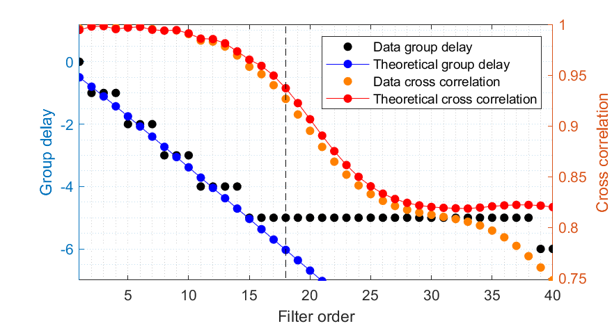
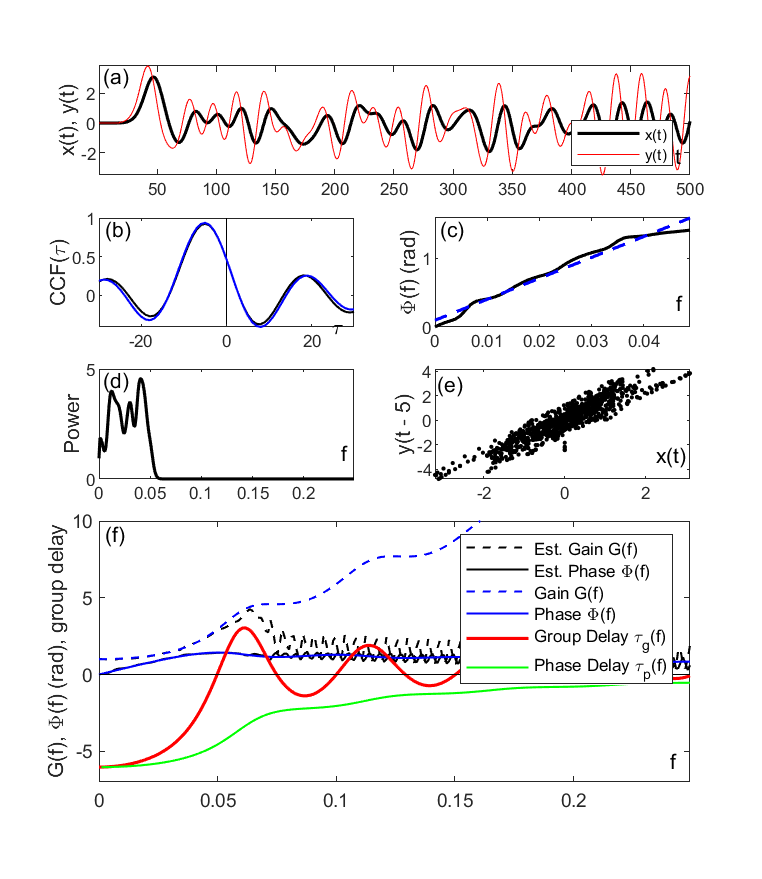

# A Filter with Delayed Feedback, Its Negative Group Delay

Filter with delay feedback, which has negative group delay. For chaotic systems, this filter has predictive ability in the high predictability stage (Matlab code implementation).
\n        \n  
\n        \n  

## Images

<!-- PAYMENT_BLOCK -->

## Get this dataset

- Payment link (Stripe): [Buy now](https://buy.stripe.com/3cs8yP7sY87d0vu9AB)
- Payment QR code: 

<!-- /PAYMENT_BLOCK -->
